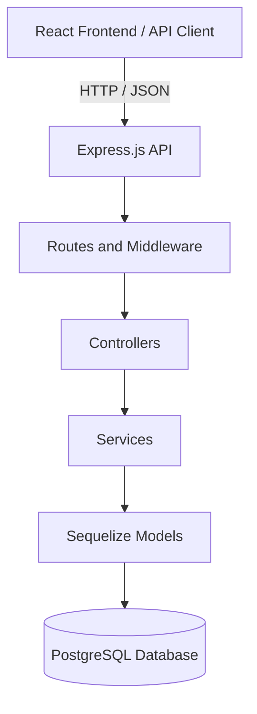
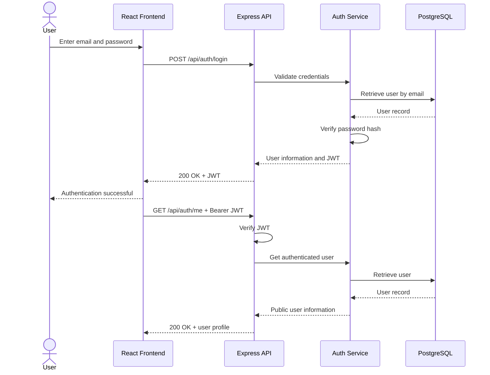

# API Architecture Overview

## 1. Overview

The Predictive Business Analytics API is implemented using Node.js and Express.js. It follows a layered architecture that separates HTTP routing, request validation, business logic, and database access.

The backend uses PostgreSQL for data storage and Sequelize ORM for database operations.

The currently implemented API provides a health check and user authentication functionality. Server-side analytics and analysis history are planned for future development stages.

## 2. Architecture Diagram

_Figure 1. High-level backend API architecture._

The main architectural components have the following responsibilities:

- **API Client:** Sends HTTP requests and processes API responses.
- **Express Routes and Middleware:** Direct requests to the appropriate handlers and apply authentication, rate limiting, and request-processing middleware.
- **Controllers:** Validate incoming data, invoke the required services, and return HTTP responses.
- **Services:** Implement authentication and user management logic.
- **Sequelize Models:** Provide access to PostgreSQL tables through the ORM.
- **PostgreSQL:** Stores user accounts and other application data.

## 3. Authentication Request Flow

The following diagram illustrates the login and authenticated profile retrieval workflow.

_Figure 2. Authentication and protected request sequence._

During login, the backend validates the request, retrieves the user from the database, verifies the password hash, and issues a JWT.

For protected requests, authentication middleware verifies the supplied JWT before the request reaches the protected controller. Invalid or expired tokens result in an HTTP 401 response.

## 4. API Resources

The currently implemented API contains two main resource groups:

| Resource       | Endpoints                                                             | Purpose                                                               |
| -------------- | --------------------------------------------------------------------- | --------------------------------------------------------------------- |
| Health         | `GET /api/health`                                                     | Check HTTP API availability                                           |
| Authentication | `POST /api/auth/register`, `POST /api/auth/login`, `GET /api/auth/me` | Manage registration, authentication, and authenticated user retrieval |

The detailed API contracts are defined in [`../openapi.yaml`](../openapi.yaml).

## 5. Current Scope and Future Extensions

The current API implementation focuses on authentication and supporting infrastructure.

Future development will introduce server-side data processing, exploratory data analysis, forecasting, customer segmentation, and analysis history.

The documented architecture provides a foundation for these additions while keeping the routing, business logic, and persistence layers separated.
